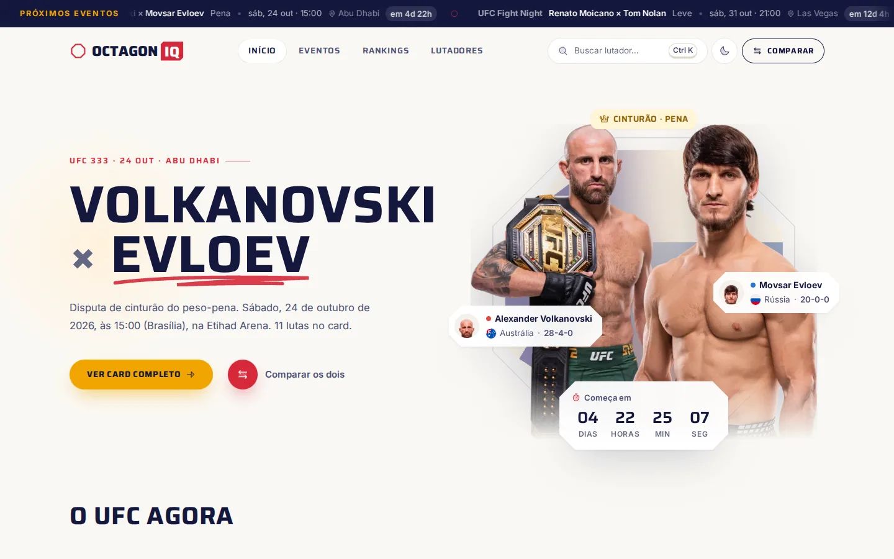
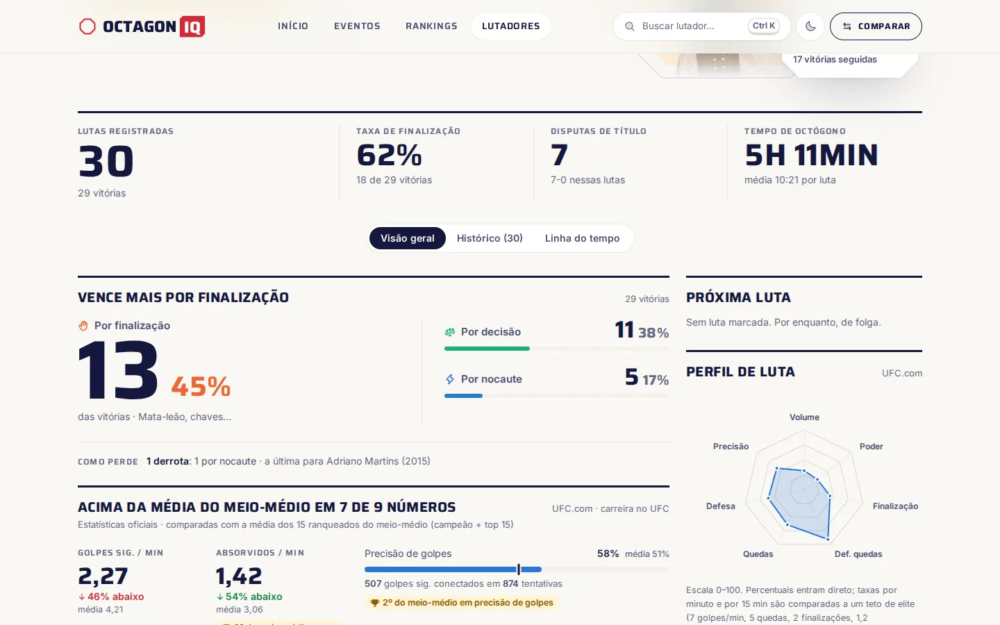
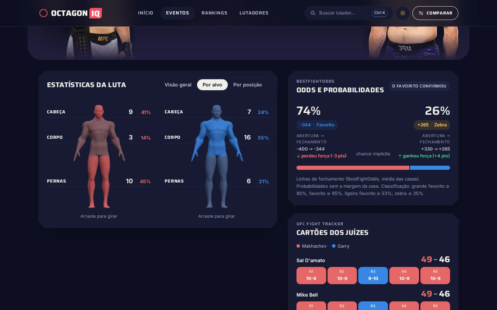
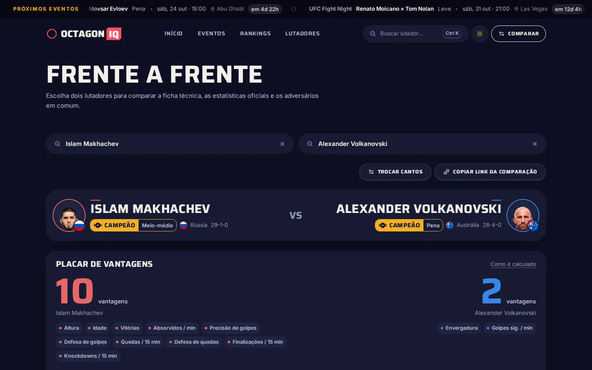
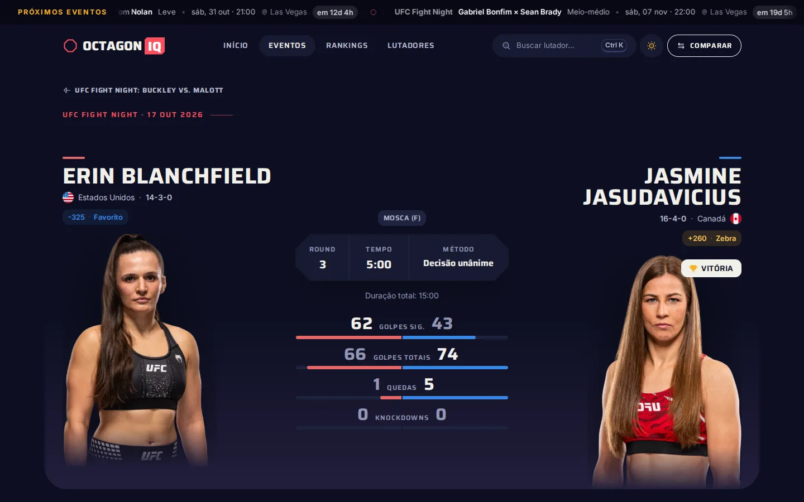
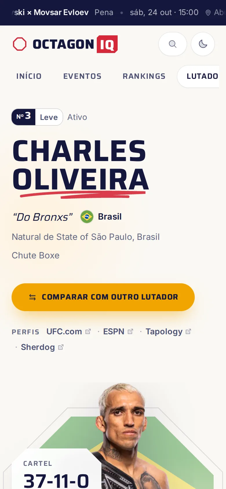

# OctagonIQ

[](https://github.com/Lucas-Romano-Pacheco/octagoniq/actions/workflows/ci.yml)

**Hub de dados do UFC em português:** calendário, cards ao vivo, resultados, rankings oficiais, odds, estatísticas e histórico de cada lutador, comparação frente a frente e cartões dos juízes. Projeto de portfólio, sem vínculo com o UFC ou a ESPN.

**🔗 Site no ar: [octagoniq.vercel.app](https://octagoniq.vercel.app)**

| Início | Perfil do lutador |
|---|---|
|  |  |

| Luta: boneco 3D, odds e cartões dos juízes | Comparador |
|---|---|
|  |  |

| Luta (modo noturno) | Celular |
|---|---|
|  |  |

## O que tem

- **Início:** próximo evento com contagem regressiva, top 5 peso por peso (masculino e feminino), destaques do último evento (zebra, maior favorito, bônus do UFC), os 11 campeões e a agenda.
- **Eventos:** calendário mensal (como o Google Agenda), card completo com resultados, **faixa ao vivo** durante o evento (luta em andamento, round e relógio, avisos de "começou" e "terminou") e resumo da noite.
- **Luta:** estatísticas por alvo num **boneco 3D** que gira com o mouse, odds com movimento da linha (abertura → fechamento), **cartões dos juízes round a round** e, para lutas futuras, uma prévia comparando a carreira dos dois.
- **Lutador:** estatísticas oficiais comparadas com a média dos ranqueados da divisão (e destaque do top 3), vitórias e derrotas por método, linha do tempo com marcos, histórico ordenável e notícias.
- **Rankings, Lutadores e Comparar:** rankings oficiais com luta marcada, filtros (brasileiros, campeões), placar de vantagens, radar de atributos e confronto direto.
- **Palpites:** escolha vencedor, método e round de cada luta do card. Os palpites fecham luta a luta e, quando os resultados saem, a página calcula acertos e pontos (10 pelo vencedor, +5 método, +5 round, +5 palpite perfeito, bônus por zebra). O botão **Salvar palpites** confirma o que foi computado e grava no banco (Supabase/Postgres), na conta de cada pessoa. A pontuação é uma função pura e testada (`src/lib/picks.ts`).
- **Ranking entre usuários:** aba dentro de Palpites com a classificação (do evento ou geral, com empate dividindo a posição) e os palpites de cada pessoa, luta a luta. O banco só revela o palpite de alguém depois do horário da luta, e palpite gravado depois do início não conta (`src/lib/picks-ranking.ts`, testado).
- **Contas:** login com **apelido e senha**, sem e-mail (apelido único, conferido enquanto a pessoa digita, e o apelido aparece no cartaz da tela de entrar) e página **Minha conta** com a pontuação somada e a troca de senha.
- **Prévias ao compartilhar:** cada luta, evento e lutador tem imagem e título próprios no WhatsApp, LinkedIn etc.

## Stack

- **React 19 + TypeScript + Vite 8**, rotas com React Router 7 e páginas em pedaços separados
- **TanStack Query 5:** cache no navegador, atualização ao vivo a cada 20 s e pré-carregamento ao passar o mouse
- **Tailwind CSS 4 + shadcn/ui (Radix)**, **Motion** (animações) e **ECharts 6** (gráficos, carregado só quando aparece)
- **three.js:** boneco 3D da aba "Por alvo", carregado só nessa aba. Modelo "Universal Base Characters", de [Quaternius](https://quaternius.itch.io/universal-base-characters), CC0 (créditos em `public/models/CREDITS.txt`)
- **BFF em Node** (`server/`): consolida as fontes, normaliza para tipos próprios e guarda cache
- **satori + resvg** (imagens de prévia) e **sharp** (fotos redimensionadas em WebP)
- Tipografia: Saira (títulos, rótulos e botões) e IBM Plex Sans (texto e tabelas). Regras de design em [`design.md`](design.md) e objetivos de cada tela em [`PRODUCT.md`](PRODUCT.md)
- Testes com **Vitest**; CI no GitHub Actions; publicação no **Vercel**

## Como rodar

Requer **Node 22.18 ou mais recente** (o servidor roda TypeScript direto, sem etapa de compilação). Nenhuma fonte exige chave de API.

```bash
git clone https://github.com/Lucas-Romano-Pacheco/octagoniq.git
cd octagoniq
npm install          # também copia as bandeiras SVG para public/flags (postinstall)
npm run dev          # http://localhost:5173 (site + /api no mesmo servidor)
```

Outros comandos:

```bash
npm test             # testes (Vitest)
npm run typecheck    # checagem de tipos
npm run build        # tipos + build em dist/
npm start            # servidor de produção: dist/ + /api + /og + /img em http://localhost:4173
```

O primeiro carregamento de um lutador leva alguns segundos (cerca de 60 chamadas às fontes); depois vem do cache.

## Fontes de dados

| Fonte | Uso | Como |
|---|---|---|
| ESPN (API pública, não documentada) | calendário, cards, resultados, bio, histórico, estatísticas por luta, odds, notícias, busca, fotos | JSON |
| UFC.com (ufc.com.br) | rankings oficiais, estatísticas oficiais de carreira, bio | leitura do HTML no servidor |
| UFC Fight Tracker | cartões dos juízes e bônus da noite | JSON |
| BestFightOdds | odds de abertura e fechamento de lutas encerradas | leitura do HTML, com cache de 7 dias |

**Tapology e Sherdog** não têm API e os termos não permitem reaproveitar o conteúdo (o Tapology também bloqueia acesso automatizado), então entram só como links no perfil de cada lutador.

As fontes não são oficiais e podem mudar sem aviso. Os adaptadores ficam isolados em `server/espn.ts`, `ufc.ts`, `bfo.ts` e `tracker.ts`, e a leitura do HTML do UFC.com e o pareamento dos cartões têm testes com amostras reais.

**Identidade do lutador:** a URL usa o slug do UFC.com. O id da ESPN é resolvido pela busca, só com nome equivalente; com homônimos, vence o cartel mais próximo do oficial, e cadastros duplicados sem foto são descartados. Sem correspondência segura, o perfil aparece sem histórico, nunca com o de outra pessoa.

## Desempenho e qualidade

- **Cache em duas camadas:** no servidor, *stale-while-revalidate* em memória e em disco (um dado vencido é entregue na hora e atualizado em segundo plano), com aquecimento ao subir; no navegador, TanStack Query persistido por 24 h. Perfil a frio: 3,3 s → servido do cache em ~1 ms.
- **Fotos redimensionadas:** `/img` entrega WebP na largura pedida (um avatar de 282 KB virou 4,6 KB).
- **Carregamento sob demanda:** páginas, gráficos, 3D e a busca são baixados só quando usados; seções abaixo da dobra só são montadas quando o visitante se aproxima.
- **Lighthouse** (build de produção, local): desktop **93–100** em desempenho, **96–100** em acessibilidade, **100** em boas práticas e SEO. No celular simulado (rede 4G lenta e CPU 4× mais lenta) o desempenho fica em 64–78. Passar disso exigiria pré-renderizar as páginas no servidor.

## Estrutura

```
shared/      tipos do domínio e traduções pt-BR (usados pelo servidor e pela interface)
server/
  http.ts        fetch com cache TTL, deduplicação, limite por host e cache em disco
  espn.ts        adaptador ESPN
  ufc.ts         adaptador UFC.com
  bfo.ts         odds históricas (BestFightOdds)
  tracker.ts     cartões dos juízes e bônus (UFC Fight Tracker)
  og.ts          prévias para compartilhar (imagens e meta tags)
  img.ts         fotos redimensionadas
  routes.ts      rotas /api/* (independentes de framework)
  dev-plugin.ts  monta tudo no servidor do Vite (npm run dev)
  index.ts       servidor de produção (npm start)
  vercel.ts      função serverless do Vercel
src/
  lib/           cliente da API (hooks) e formatação
  components/    layout, linha de luta, gráficos, boneco 3D, prévia da luta, primitivos de UI
  pages/         Início, Eventos, Evento, Rankings, Lutadores, Lutador, Luta, Comparar, Palpites, Entrar, Conta, Sobre
scripts/     build do Vercel e cópia das bandeiras
docs/        capturas de tela deste README
legacy/      versão anterior (HTML/JS puro com dados estáticos), mantida como referência
```

## API interna

| Rota | Retorno |
|---|---|
| `GET /api/upcoming?limit=8` | próximos eventos com a luta principal |
| `GET /api/schedule?year=2026` | calendário do ano |
| `GET /api/events/:id` | card completo, resultados e ao vivo (round e relógio) |
| `GET /api/events/:id/fights/:fight` | luta com estatísticas, odds e cartões dos juízes |
| `GET /api/events/:id/bonuses` | bônus da noite do UFC |
| `GET /api/rankings` · `/api/rankings/meta` | rankings oficiais · bandeira, cartel e id ESPN dos ranqueados |
| `GET /api/divisions/average?name=` | médias e posições dos ranqueados de uma divisão |
| `GET /api/booked` | quem tem luta marcada |
| `GET /api/fighters/:slug?espn=` | perfil completo |
| `GET /api/search?q=` | busca de lutadores |
| `GET /img?u=&w=` · `GET /og/...png` | foto redimensionada · imagem de prévia |

## Contas e palpites (Supabase)

Com o Supabase configurado, cada pessoa tem login próprio: o rascunho fica no navegador a cada clique e o **Salvar palpites** exige entrar e grava no banco. A segurança fica no próprio banco: RLS (cada conta só lê e altera os próprios palpites), apelido único e hora do palpite sempre a do servidor. Sem as variáveis abaixo o site continua funcionando, com os palpites só no navegador e sem tela de login. Para ativar:

1. Crie um projeto grátis em [supabase.com](https://supabase.com) e rode `docs/supabase.sql` no **SQL Editor** (cria a tabela `picks` com segurança por linha: cada pessoa só acessa os próprios palpites).
2. Em **Authentication → Providers** deixe **Email** ativo e **desligue *Confirm email***. O login é por apelido: por baixo, cada conta usa um e-mail interno (`apelido@octagoniq.vercel.app`) que nunca recebe mensagens, então a conta precisa entrar direto depois do cadastro. Para o botão do Google (opcional), ative o provedor **Google** e cadastre também `VITE_SUPABASE_GOOGLE=1`. Em **Authentication → URL Configuration** coloque o endereço do site (`https://octagoniq.vercel.app`) em *Site URL* e, junto com `http://localhost:5173`, em *Redirect URLs*.
3. Copie `.env.example` para `.env.local` e preencha `VITE_SUPABASE_URL` e `VITE_SUPABASE_ANON_KEY` (Project Settings → API). A chave `anon` é pública; quem protege os dados é o RLS.
4. No Vercel, cadastre as mesmas duas variáveis em **Settings → Environment Variables** e publique de novo.

As contas aparecem em **Authentication → Users** (com o e-mail interno), os apelidos na tabela `profiles` e os palpites na `picks`. As senhas ficam só como hash; para redefinir a de alguém, há um comando comentado no fim de `docs/supabase.sql`.

Ao entrar, os palpites da conta são baixados para o navegador e cada "Salvar palpites" é enviado para o banco. Ao sair, os palpites deixam o navegador (num aparelho compartilhado, a próxima pessoa não vê os seus); se outra conta entrar no mesmo navegador, os palpites de uma nunca sobem para a outra.

## Prévias para compartilhar (Open Graph)

Robôs de WhatsApp, LinkedIn, X etc. não executam JavaScript. O servidor reconhece esses robôs pelo User-Agent e devolve o `index.html` com título, descrição e imagem da página (`server/og.ts`). As imagens 1200×630 são geradas na hora em `/og/luta/:evento/:luta.png`, `/og/lutador/:slug.png`, `/og/evento/:id.png` e `/og/padrao.png` e ficam 12 h em cache.
Para testar: `curl -A "WhatsApp" http://localhost:4173/lutadores/charles-oliveira`.

## Publicar no Vercel

O build `npm run vercel-build` gera `.vercel/output` no formato da [Build Output API](https://vercel.com/docs/build-output-api/v3): o site estático (`dist/`) e a API, as fotos e as prévias empacotadas numa função serverless (`server/vercel.ts`, mesmas rotas de `server/routes.ts`). O `vercel.json` já aponta para esse comando.

1. Envie o repositório para o GitHub.
2. Em [vercel.com](https://vercel.com), **Add New → Project**, importe o repositório e clique em **Deploy** (nenhuma configuração extra).

No Vercel o cache fica em `/tmp`, que só dura enquanto a instância da função estiver ativa; as respostas da API também ficam na CDN (`s-maxage`). Um perfil montado a frio leva alguns segundos (limite da função: 60 s).

## Créditos

Dados: ESPN, UFC.com, UFC Fight Tracker e BestFightOdds. Modelo 3D: Quaternius (CC0). Bandeiras: circle-flags e flag-icons. Ícones: Phosphor. Fontes: Saira e IBM Plex Sans.
Feito por **Lucas Pacheco**.
